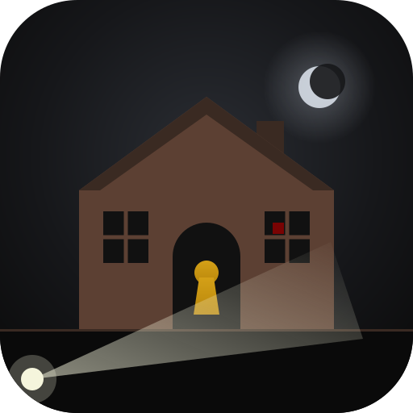

<p align="center">
  
</p>

# La Casa Abandonada

Aventura en primera persona de escape y misterio, en 3D, hecha con **Godot 4**. Camila, una restauradora de cerraduras, queda atrapada en la casa de su abuela Inés, desaparecida hace diez años. Para salir tiene que abrir las puertas una por una, con la linterna como única defensa, antes de que **la presencia** que camina con ella en la oscuridad la alcance.

Proyecto del curso *Desarrollo Conceptual de Videojuegos* (Uniempresarial).

| | |
|---|---|
| **Género** | Aventura en primera persona, escape room, misterio |
| **Plataforma** | PC (Windows) |
| **Motor** | Godot 4.7, renderer GL Compatibility, física Jolt |
| **Duración de una partida** | 20 a 40 minutos (estimada, pendiente de pruebas de juego) |
| **Referentes** | Resident Evil 7, Outlast, Escape Simulator |

## Cómo se juega

No hay combate. Se explora cada habitación, se examinan los objetos que no tienen polvo (los que Inés tocó por última vez), se leen sus notas y se usan las llaves encontradas para abrir la siguiente puerta. La linterna ayuda a ver, pero su batería es limitada, y la presencia se acerca cuando la luz se apaga.

### Controles

| Acción | Control |
|---|---|
| Moverse | `W` `A` `S` `D` |
| Mirar | Mouse |
| Interactuar / recoger | Clic izquierdo |
| Usar el objeto seleccionado (por ejemplo, una llave en una puerta) | `E` |
| Linterna | `F` |
| Leer una nota | Clic derecho |
| Pausa y opciones | `Esc` |

## Estado actual

Lo que ya funciona en la escena principal (`main.tscn`):

- **Menú principal y menú de pausa**, con volumen y pantalla completa.
- **Jugador** con movimiento, cámara, pasos con sonido, interacción con objetos y visor de notas.
- **Inventario** con objetos recogibles y selección del objeto activo.
- **Linterna** con batería que se gasta mientras está encendida y se debilita cuando queda poca. Hay baterías de recarga en el mapa.
- **Puertas** que se abren con su llave, que se consume al usarla.
- **Cocina:** gabinete, cuchillo, llave y nota con pistas.
- **Sala / comedor:** panel de cuatro símbolos (luna, ojo, mano, puerta) que debe pulsarse en el orden correcto para abrir el cajón de la cómoda, donde está la llave.
- **Corredor:** cuadro de retrato que se completa colocando seis fragmentos.
- **La presencia:** un fantasma que aparece en la oscuridad y se acerca al jugador; el efecto de desaturación y la viñeta suben con su cercanía.

## Cómo ejecutarlo

1. Instala **Godot 4.7** (versión estándar, sin .NET).
2. Clona el repositorio:
   ```bash
   git clone https://github.com/Panteve/Casa_abandonada_videojuego.git
   ```
3. Abre Godot, pulsa *Importar* y elige el archivo `project.godot`.
4. Espera a que se importen los assets la primera vez y pulsa `F5`. La escena de inicio es el menú principal.

## Estructura del proyecto

```
assets/        Audios, modelos 3D, texturas y escenario importados
inventario/    Inventario, ítems y objetos recogibles
mundo/         Puertas, cómoda y cajón, gabinete, panel de símbolos y cuadro de retrato
objetos/       Llave, nota, batería, cuchillo y fragmento de retrato, con sus recursos
player/        Jugador, interacción, entrada, lector de notas y linterna
presencia/     El fantasma que persigue al jugador
ui/            Menú principal, pausa, mira, HUD de batería y viñeta
main.tscn      Escena principal con la cocina, la sala y el corredor
```

## Documentación

El diseño completo está en el *Documento de Concepto: La Casa Abandonada* (Corte 1): ficha, jugador objetivo, referentes, sinopsis, mecánicas, intención visual y alcance. El juego ha cambiado respecto a ese documento en algunos puntos, por ejemplo la linterna con batería limitada y la presencia que persigue al jugador.

## Equipo

- Andrés Felipe Chiquiza Rativa: diseño y programación
- Diego Rojas: diseño y programación
- Omar Isaac Niño Macías: programación de UI y sonido

## Uso de IA

Parte de la mecánica del panel de símbolos y del cajón se desarrolló con ayuda de Claude (Anthropic). Está indicado en la cabecera de `mundo/panel_simbolos/panel_simbolos.gd` y el equipo la revisó y probó en el juego.

## Créditos de assets

Los audios (puerta y pasos), el escenario *Abandoned Apartment* y los modelos 3D (llave, cuchillo, gabinete, cómoda, papel y fantasma) son de terceros. Antes de publicar el juego hay que revisar y anotar aquí la fuente y la licencia de cada uno.
